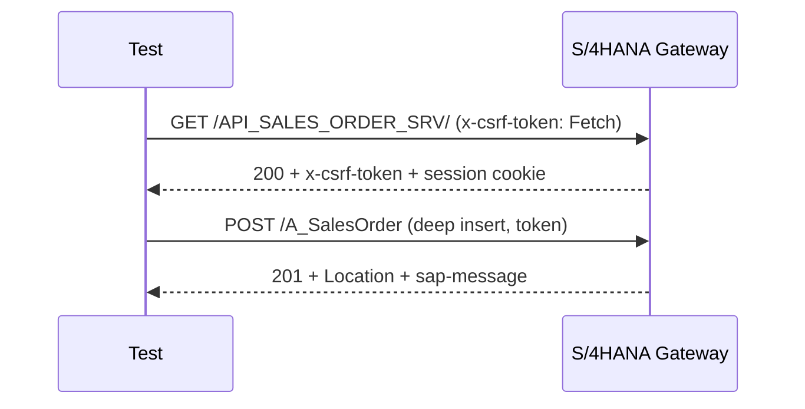

# SAP OData API Tests (V2 + V4)

[](https://github.com/mukeshn/sap-odata-api-tests/actions/workflows/playwright.yml)
[](https://mukeshn.github.io/sap-odata-api-tests/)


[](LICENSE)

API-level regression tests for SAP S/4HANA style OData services. The V2 tests target `API_SALES_ORDER_SRV` and `API_BUSINESS_PARTNER` (Basic auth, CSRF, SAP error format). The V4 tests target a CAP-style catalog service.

<details open>
<summary><b>Checklist</b></summary>

**V2 · API_SALES_ORDER_SRV**
- [x] `$filter` with `eq` / `ne` / `gt` / `and` / `or`, `substringof()`, `startswith()`
- [x] `$orderby` with multiple keys, `$select`, `$top`/`$skip`
- [x] `$inlinecount=allpages` equals `/$count`
- [x] navigation `/to_Item`, `__metadata.uri`
- [x] CSRF: token only on `Fetch`, 403 without or with a forged token
- [x] deep insert → read → PATCH → DELETE
- [x] `errordetails` targets for every invalid field

**V4 · catalog**
- [x] `OData-Version: 4.0`, `@odata.context`, `@odata.count`
- [x] `contains()`, `$expand`, `$select`, paging, entity by key, `$metadata`
</details>



```bash
npm ci && npx playwright test
BASE_URL=https://my-s4.example.com npx playwright test   # against a real gateway
```
